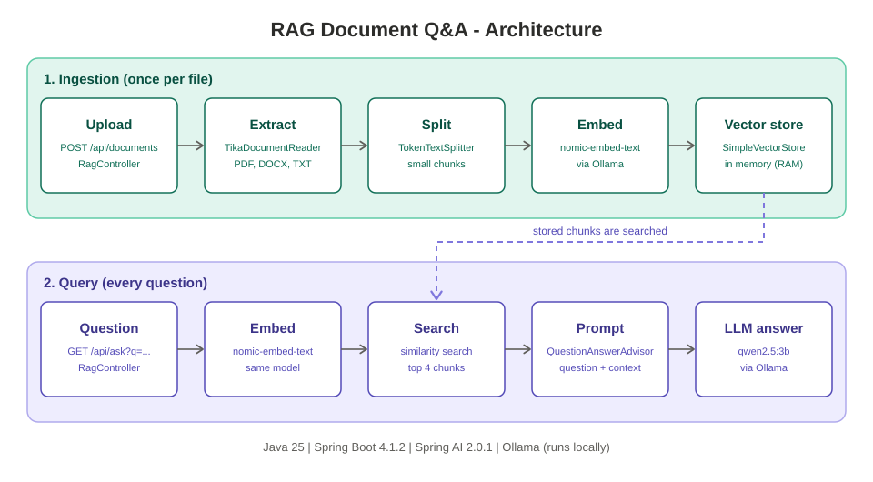

# RAG Document Q&A

A local Retrieval-Augmented Generation service: upload documents, then ask questions answered using their content. Everything runs locally via [Ollama](https://ollama.com) — no external API calls.



## Stack

- Java 25, Spring Boot 4.1.2, Maven
- Spring AI 2.0.1
- Ollama (local) — chat model `qwen2.5:3b`, embedding model `nomic-embed-text`
- `SimpleVectorStore` (in-memory vector store)
- Apache Tika (`spring-ai-tika-document-reader`) for parsing uploaded files (PDF, DOCX, TXT, ...)

## Prerequisites

- Java 25
- [Ollama](https://ollama.com) running locally with both models pulled:
  ```
  ollama pull qwen2.5:3b
  ollama pull nomic-embed-text
  ```

## Running

```
mvn spring-boot:run
```

The app starts on `http://localhost:8080`.

## API

### Upload a document

```
curl -X POST http://localhost:8080/api/documents -F "file=@/path/to/file.txt"
```

The file is parsed, split into chunks, embedded, and stored in the in-memory vector store.

### Ask a question

```
curl -G "http://localhost:8080/api/ask" --data-urlencode "q=your question here"
```

The question is embedded, the most relevant chunks are retrieved from the vector store, and `qwen2.5:3b` answers using that context.

